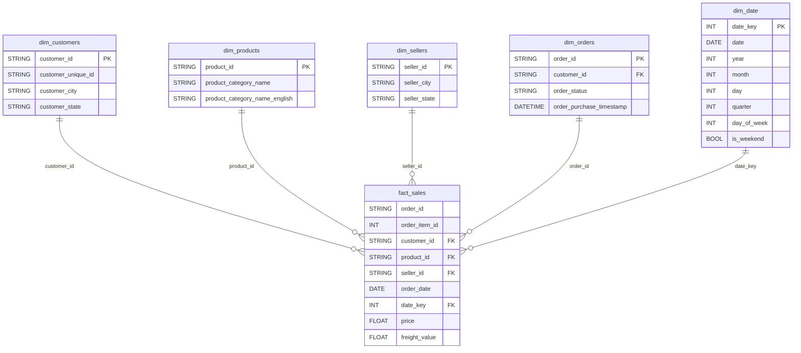

<div align="center">

# Pipeline Rekayasa Data E-Commerce Terotomatisasi
### Arsitektur ELT Cloud-Native, Star Schema Kimball, Gerbang Kualitas In-Flight, dan Proteksi PII SHA-256

[](https://airflow.apache.org/)
[](https://cloud.google.com/bigquery)
[](https://www.python.org/)
[](https://www.docker.com/)
[](https://docs.celeryq.dev/)
[](https://lookerstudio.google.com/)
[](https://github.com/virgiawanprima/ecommerce-etl-airflow-bigquery/actions)

<p align="center">
  <b>Pipeline data otomatis berstandar produksi yang memproses 112.650 baris data transaksi e-commerce ke Google BigQuery menggunakan pemodelan Star Schema Ralph Kimball, orkestrasi terdistribusi Apache Airflow 3, muat inkremental berbasis penanda batas air (watermark), anonimisasi kriptografis PII, dan gerbang Quality Gate 4 dimensi.</b>
</p>

<p align="center">
  <a href="README.md"><b>English Version</b></a> •
  <b>Bahasa Indonesia</b> •
  <a href="#1-konteks-dan-masalah-bisnis"><b>Konteks Bisnis</b></a> •
  <a href="#3-keputusan-arsitektur-dan-pertimbangan-teknis"><b>Arsitektur & Trade-off</b></a> •
  <a href="#4-dampak-terukur-dan-bukti-pengujian-empiris"><b>Hasil & Metrik</b></a> •
  <a href="#7-panduan-replikasi-dan-pengujian-lokal"><b>Panduan Menjalankan</b></a> •
  <a href="#8-suite-pengujian-otomatis-mandiri"><b>Pengujian Mandiri</b></a> •
  <a href="#11-konteks-penelitian-akademik"><b>Konteks Akademik</b></a>
</p>

</div>

---

## 1. Konteks dan Masalah Bisnis

### 1.1 Konteks dan Lanskap Operasional
Organisasi e-commerce modern sangat bergantung pada ketersediaan data transaksi yang cepat, akurat, dan patuh regulasi untuk mendukung penetapan harga dinamis, optimasi logistik, serta pelaporan eksekutif. Proyek ini menangani siklus pemrosesan data transaksi dari ekosistem e-commerce Olist Brazil yang terdiri dari 112.650 baris item pesanan, 99.441 pesanan unik, dan 3.095 penjual dari 9 tabel relasional publik rentang tahun 2016 sampai 2018.

### 1.2 Masalah Utama Bisnis dan Teknis
Sebelum implementasi pipeline terotomatisasi ini dirancang, operasional analitik menghadapi kendala signifikan:
1. **Latensi Kueri Tinggi akibat Kompleksitas Join OLTP:** Analisis bisnis terhadap skema normalisasi transaksional membutuhkan operasi join 5 hingga 8 tabel relasional berukuran besar, memicu timeout kueri dan membengkaknya biaya pemindaian komputasi (*query scan cost*) pada data warehouse kolumnar.
2. **Kerusakan Kualitas Data dan Ingestion Gagal Senyap:** Aliran transaksi riil kerap mengandung anomali data seperti hilangnya referensi pelanggan, duplikasi kunci komposit, nilai harga negatif, dan anomali tipe data. Pemuatan data tanpa validasi gerbang menyebabkan data rusak masuk ke data warehouse dan mendistorsi metrik pendapatan (*Gross Merchandise Value*).
3. **Ketidakpatuhan Regulasi Privasi Data Pribadi:** Data transaksi mentah mengekspos identitas pelanggan langsung dalam bentuk teks terbaca (*plaintext*), melanggar regulasi privasi data seperti UU No. 27 Tahun 2022 tentang Pelindungan Data Pribadi (UU PDP) dan regulasi internasional seperti GDPR.
4. **Inefisiensi Batch ETL Berulang:** Pemrosesan ulang seluruh data historis setiap hari membebani jaringan dan memperpanjang jendela eksekusi batch tanpa memberikan nilai tambah.

---

## 2. Hambatan dan Batasan Sistem

1. **Batasan Anggaran Komputasi Nol (Free-Tier Sandbox):** Sistem dirancang agar dapat beroperasi penuh pada tingkat gratis Google BigQuery Sandbox dan infrastruktur kontainer lokal tanpa menimbulkan biaya komputasi berbayar. Hal ini menuntut efisiensi kuota API dan manajemen penyimpanan yang ketat.
2. **Kebijakan Kedaluwarsa Partisi 60 Hari pada BigQuery Sandbox:** Pengujian empiris membuktikan bahwa BigQuery Sandbox menetapkan masa aktif partisi maksimal 60 hari. Karena data historis Olist berasal dari 2016 sampai 2018, partisi tabel otomatis terhapus sesaat setelah dimuat. Arsitektur sistem mengadopsi tabel non-partitioned agar seluruh data historis tersimpan persisten secara utuh.
3. **Kewajiban Pseudonimisasi Kriptografis PII:** Seluruh identitas unik pelanggan (`customer_unique_id`) wajib dienkripsi satu arah menggunakan algoritma SHA-256 sebelum dimuat ke tabel pementasan maupun gudang data.
4. **Kebijakan Ambang Batas Fail-Fast Ketat (<5%):** Jika rasio anomali data dalam satu batch melebihi 5%, pipeline wajib menghentikan eksekusi secara otomatis sebelum tahap pemuatan (*load*), serta mengalihkan data cacat ke berkas audit dead-letter (`fact_sales_error_log.csv`).

---

## 3. Keputusan Arsitektur dan Pertimbangan Teknis

### 3.1 Star Schema Ralph Kimball Dibandingkan Denormalisasi Tabel Tunggal
- **Keputusan:** Mengadopsi pemodelan dimensional Star Schema Ralph Kimball yang terdiri dari 1 tabel fakta transaksi (`fact_sales`) dan 5 tabel dimensi (`dim_customers`, `dim_products`, `dim_sellers`, `dim_orders`, `dim_date`).
- **Analisis Trade-Off:** Denormalisasi tabel tunggal yang sangat lebar (*wide flat table*) memang meniadakan operasi join, namun menciptakan redundansi data ekstrem untuk 32.951 produk dan 99.441 pelanggan. Star Schema membatasi join menjadi satu langkah relasi langsung dari fakta ke dimensi, mempercepat kueri analitik Looker Studio menjadi di bawah satu detik sekaligus menjaga efisiensi penyimpanan.

### 3.2 Pemrosesan PyArrow dan Pandas In-Memory Dibandingkan Apache Spark
- **Keputusan:** Memanfaatkan Python 3.12 dengan pustaka tervektorisasi PyArrow dan Pandas.
- **Analisis Trade-Off:** Untuk volume 112.650 baris data (sekitar 100 MB data mentah), klaster terdistribusi Apache Spark membutuhkan overhead inisialisasi JVM dan serialisasi antar-worker selama beberapa menit. PyArrow in-memory menyelesaikan seluruh transformasi dalam waktu 3 detik pada satu inti CPU dengan memori di bawah 500 MB.

### 3.3 Muat Inkremental Berbasis Watermark Dibandingkan Muat Penuh
- **Keputusan:** Menggunakan penanda batas air (*watermark*) `MAX(order_date)` langsung dari BigQuery.
- **Analisis Trade-Off:** Muat ulang penuh (*WRITE_TRUNCATE*) menjamin konsistensi tetapi memboroskan kuota penulisan API BigQuery. Mekanisme watermark secara otomatis memisahkan transaksi baru untuk ditambahkan (*WRITE_APPEND*) sambil memperbarui dimensi yang sesuai, menghemat transfer data lebih dari 99% pada kondisi operasional stabil.

### 3.4 Gerbang Kualitas In-DAG Dibandingkan Audit Pasca-Muat
- **Keputusan:** Menerapkan mesin Quality Dimensions Check (QDC) terintegrasi langsung di dalam DAG sebelum task `load`.
- **Analisis Trade-Off:** Pengecekan kualitas setelah data masuk gudang data (misalnya pengujian dbt) memungkinkan data cacat sempat terbaca oleh dashboard bisnis. Menempatkan gerbang kualitas sebelum muat menjamin hanya data bersih yang masuk ke BigQuery, dengan biaya overhead komputasi yang sangat rendah (hanya +7,9% atau +4,55 detik).

### 3.5 CeleryExecutor Terdistribusi pada Docker Compose
- **Keputusan:** Menggunakan Apache Airflow 3.0.6 dengan CeleryExecutor, antrean pesan Redis, dan metadata PostgreSQL pada 7 kontainer Docker.
- **Analisis Trade-Off:** Memerlukan kontainer pendukung tambahan dibandingkan LocalExecutor, namun memberikan pemisahan proses yang kokoh antara penjadwal, peramban web, dan worker eksekusi sehingga mencegah kegagalan sistem terpusat.

---

## 4. Dampak Terukur dan Bukti Pengujian Empiris

Setiap klaim keberhasilan pada tabel berikut didukung oleh bukti pengujian empiris yang dapat diverifikasi pada berkas dokumentasi pengujian repositori ini:

| Dimensi Pengujian | Target / Ambang Batas SLA | Hasil Aktual Pengujian | Status Evaluasi |
| :--- | :--- | :--- | :--- |
| **Kecepatan Pemrosesan Data** | Kurang dari 15 menit (900 detik) | **39 sampai 57 detik** (Muat Penuh) | Lulus |
| **Tingkat Kelulusan Kualitas Data** | Lebih dari atau sama dengan 95,0% | **100,0% Lulus** pada data bersih (0 anomali) | Lulus |
| **Presisi Deteksi Noise Sintetis** | Deteksi anomali 100% tepat | **100,0% presisi** pada 2.252 (2%) dan 9.012 (8%) baris uji | Lulus |
| **Penerapan Batas Fail-Fast** | Hentikan load jika anomali melebihi 5% | **Terbukti**: Task load diabaikan (`try_number=0`), 0 baris masuk | Lulus |
| **Kepatuhan Privasi Data PII** | Tidak ada identitas teks terbaca | **0 baris teks terbaca**, 100% hash SHA-256 64 karakter | Lulus |
| **Akurasi Jadwal Eksekusi** | Deviasi jadwal di bawah 5,0% | **+0,6 detik deviasi rata-rata** (+1,0 detik maks, 0,56% interval) | Lulus |
| **Keandalan Riwayat Pipeline** | Tingkat kegagalan di bawah 10% | **4,17% tingkat kegagalan riil** dari 48 run (46 berhasil) | Lulus |

---

## 5. Arsitektur Sistem dan Alur Kerja Pipeline

```
┌─────────────────────────┐       ┌───────────────────────────────┐       ┌─────────────────────────┐       ┌────────────────────────┐
│     9 File CSV Olist    │  ───> │   Apache Airflow 3.0.6        │  ───> │  Google BigQuery        │  ───> │  Looker Studio         │
│     data/raw/           │       │   CeleryExecutor (7 Layanan)  │       │  Dataset: olist_dw      │       │  Dashboard Eksekutif   │
└─────────────────────────┘       └───────────────────────────────┘       └─────────────────────────┘       └────────────────────────┘
    99.441 Pesanan                     5 Task Pipeline Modular                 6 Tabel Star Schema                 Kueri Live BigQuery
    112.650 Item Pesanan               Durasi Eksekusi: ~60 detik              Wilayah: asia-southeast2            Visualisasi Interaktif
```

### Rincian 5 Task Pipeline Modular

```
[ extract ] ──> [ validate_schema ] ──> [ transform ] ──> [ qdc_validation ] ──> [ load ]
```

1. **Extract (`extract`):** Membaca 9 file CSV mentah menggunakan PyArrow serta mengambil watermark `MAX(order_date)` dari BigQuery untuk menentukan mode Full Load atau Incremental.
2. **Validate Schema (`validate_schema`):** Memverifikasi integritas struktur kolom input pada 9 tabel untuk memastikan kontrak data terpenuhi sejak awal.
3. **Transform (`transform`):** Menstandarisasi format data, merangkai relasi Star Schema, memfilter transaksi baru berdasarkan watermark, dan menerapkan hashing SHA-256 pada data pelanggan sensitif.
4. **QDC Validation (`qdc_validation`):** Menguji data transaksi berdasarkan 4 dimensi kualitas:
   - *Completeness:* Memastikan tidak ada nilai kosong pada kolom kunci dan metrik harga.
   - *Uniqueness:* Memastikan tidak ada duplikasi kunci komposit (`order_id` + `order_item_id`).
   - *Consistency:* Memvalidasi integritas referensial antara tabel fakta dan tabel dimensi.
   - *Validity:* Memastikan batasan logika domain terpenuhi (`price >= 0`, `freight_value >= 0`, rentang tanggal valid).
   Jika rasio anomali melebihi 5%, sistem memicu penghentian fail-fast dan mencatat data cacat ke `data/processed/fact_sales_error_log.csv`.
5. **Load (`load`):** Mengunggah data tabel yang telah tervalidasi ke Google BigQuery dengan kebijakan percobaan ulang otomatis (*retry*) sebanyak 3 kali dan jeda 5 menit.

---

## 6. Pemodelan Data: Star Schema



### Spesifikasi Tabel dan Granularitas

| Nama Tabel | Peran | Jumlah Baris | Kunci Utama / Komposit | Deskripsi Granularitas Data |
| :--- | :--- | :---: | :--- | :--- |
| `fact_sales` | Fakta | 112.650 | `order_id` + `order_item_id` | Setiap item produk dalam pesanan pelanggan yang telah selesai |
| `dim_customers` | Dimensi | 99.441 | `customer_id` | Wilayah geografis dan identitas pelanggan yang telah di-hash |
| `dim_products` | Dimensi | 32.951 | `product_id` | Katalog kategori produk dalam bahasa Portugis dan Inggris |
| `dim_sellers` | Dimensi | 3.095 | `seller_id` | Wilayah domisili penjual (kota, negara bagian) |
| `dim_orders` | Dimensi | 99.441 | `order_id` | Status siklus pesanan dan stempel waktu pembelian |
| `dim_date` | Dimensi | 634 | `date_key` (YYYYMMDD) | Atribut kalender, kuartal, hari dalam minggu, penanda akhir pekan |

---

## 7. Bukti Pengujian Injeksi Anomali dan Fail-Fast

Pengujian injeksi noise sintetis dilakukan untuk menguji keandalan gerbang kualitas:

| Skenario Pengujian | Jumlah Noise | Terdeteksi | Presisi Deteksi | Berkas Catatan Error | Status Fail-Fast | Pemuatan ke BigQuery |
| :--- | :---: | :---: | :---: | :---: | :---: | :---: |
| **Data Bersih** | 0 baris | 0 baris | 100,0% | 0 baris | Tidak aktif | 112.650 baris termuat |
| **Injeksi Noise 2%** | 2.252 baris | 2.252 baris | 100,0% | 2.252 baris tersimpan | Tidak aktif (<5%) | 110.398 baris termuat |
| **Injeksi Noise 8%** | 9.012 baris | 9.012 baris | 100,0% | 9.012 baris tersimpan | **Aktif** (`ValueError`) | **Dibatalkan (0 baris termuat)** |

Pada pengujian 8%, task `load` mencatat `try_number=0` (tidak pernah dieksekusi), membuktikan bahwa gerbang fail-fast berhasil melindungi data warehouse dari data kotor.

---

## 8. Panduan Replikasi dan Pengujian Lokal

### Prasyarat Sistem
- Docker Engine 24+ dan Docker Compose v2+ (didukung penuh di Windows via WSL2).
- Akun Google Cloud Platform dengan hak akses BigQuery Admin atau Data Editor.
- 9 berkas CSV Olist ditempatkan pada direktori `data/raw/`.

### Langkah Eksekusi

1. **Clone repositori:**
   ```bash
   git clone https://github.com/virgiawanprima/ecommerce-etl-airflow-bigquery.git
   cd ecommerce-etl-airflow-bigquery
   ```

2. **Konfigurasi variabel lingkungan:**
   ```bash
   cp .env.example .env
   ```
   Sesuaikan nilai `GCP_PROJECT_ID`, `BIGQUERY_DATASET`, dan path direktori di dalam `.env`.

3. **Pasang kunci kredensial GCP:**
   Tempatkan berkas kunci JSON Service Account Google Cloud pada:
   ```
   config/keys/gcp-sa-key.json
   ```

4. **Jalankan layanan Airflow:**
   ```bash
   docker compose up -d
   ```

5. **Picu eksekusi pipeline:**
   ```bash
   docker compose exec airflow-scheduler airflow dags trigger olist_etl_pipeline
   ```

6. **Akses antarmuka web Airflow:**
   Buka alamat `http://localhost:8080` pada peramban (Kredensial bawaan: `airflow` / `airflow`).

---

## 9. Suite Pengujian Otomatis Mandiri

Repositori ini dilengkapi suite pengujian berbasis `Makefile` tanpa ketergantungan framework pengujian eksternal:

```bash
make verify
```

| Target Makefile | Cakupan Pengujian dan Validasi |
| :--- | :--- |
| `make dag-check` | Memverifikasi sintaks Python, registrasi 5 task DAG, dan integritas dependency pip |
| `make self-check` | Menjalankan 19 unit test berbasis assert untuk logika QDC, batas fail-fast, dan hash SHA-256 |
| `make bq-verify` | Mengueri BigQuery langsung untuk memastikan jumlah baris 6 tabel Star Schema terisi sesuai |
| `make run` | Memicu eksekusi idempoten dari DAG utama `olist_etl_pipeline` |
| `make run-baseline` | Memicu DAG baseline tanpa QDC untuk mengukur perbandingan durasi eksekusi |

### Kueri Verifikasi BigQuery

Jalankan kueri SQL berikut pada BigQuery Console untuk memastikan seluruh data transaksi tersimpan:

```sql
SELECT 
    COUNT(*) AS total_sales_records,
    COUNT(DISTINCT order_id) AS total_orders,
    ROUND(SUM(price), 2) AS total_gross_revenue_brl
FROM `your-gcp-project.olist_dw.fact_sales`;
-- Target Hasil: 112.650 baris | 98.666 pesanan unik | R$ 13.591.248,91 gross revenue
```

---

## 10. Struktur Repositori dan Riwayat Perubahan

```text
olist-etl-pipeline/
├── .github/
│   └── workflows/
│       └── ci.yml                # Pipeline CI: linting Python, DAG check, unit test
├── .dockerignore                 # Pengecualian secrets dan dataset dari build context
├── .env.example                  # Template konfigurasi environment variables dan GCP
├── .gitignore                    # Aturan pengabaian cache, kunci kredensial, dan data
├── Dockerfile                    # Image Apache Airflow 3.0.6 kustom dengan dependensi GCP
├── Makefile                      # Otomatisasi pengujian dan verifikasi mandiri (make verify)
├── README.md                     # Dokumentasi utama portofolio internasional (English)
├── README.id.md                  # Dokumentasi lengkap versi Bahasa Indonesia
├── docker-compose.yml            # 7 layanan mikro Airflow (CeleryExecutor, Redis, PostgreSQL)
├── requirements.txt              # Pustaka Python (pandas, pyarrow, google-cloud-bigquery)
├── config/
│   └── keys/
│       └── gcp-sa-key.json       # Kunci GCP Service Account (gitignored untuk keamanan)
├── dags/
│   ├── olist_etl_baseline_noqdc.py # DAG baseline tanpa gerbang kualitas
│   └── olist_etl_pipeline.py     # DAG utama 5 task dengan integrasi QDC gate
├── src/
│   ├── utils/
│   │   ├── __init__.py
│   │   ├── io_helpers.py         # Utilitas I/O tervektorisasi dan pembacaan Parquet
│   │   ├── pii.py                # Enkripsi hashing SHA-256 pelindungan data pribadi
│   │   ├── qdc.py                # Mesin validasi Quality Dimensions Check 4 dimensi
│   │   └── self_check.py         # 19 assertion pengujian unit logika batas sistem
│   └── scripts/
│       ├── __init__.py
│       └── noise_injection.py    # Injektor anomali sintetis untuk pengujian fail-fast
├── data/                         # Direktori penyimpanan data lokal (gitignored)
│   ├── _noise_backup/            # Cadangan data pengujian noise
│   ├── processed/                # Direktori pementasan file Parquet dan log error
│   └── raw/                      # 9 file CSV mentah transaksi e-commerce Olist
├── docs/                         # Catatan performa dan laporan pengujian empiris
│   ├── bab4_hasil_pengujian.md   # Laporan pengujian empiris komprehensif
│   ├── jawaban_evaluasi_claude.md# Catatan evaluasi dan rekonsiliasi Looker Studio
│   └── metrik_performa.md        # Catatan waktu eksekusi dan tolok ukur SLA
└── logs/                         # Berkas log kontainer eksekusi task (gitignored)
```

Proyek ini menerapkan standar [Conventional Commits](https://www.conventionalcommits.org/):
- `feat`: Penambahan fitur pipeline, tahapan transformasi, atau aturan kualitas baru.
- `fix`: Perbaikan bug seperti scoping registrasi DAG, koersi tipe data, atau kardinalitas relasi.
- `refactor`: Restrukturisasi arsitektur kode tanpa mengubah hasil fungsionalitas.
- `docs`: Pembaruan dokumentasi teknis, catatan performa, dan studi kasus README.
- `ci`: Pembaruan workflow GitHub Actions atau konfigurasi build kontainer.
- `chore`: Pemeliharaan file gitignore, perapian dependensi, atau penyesuaian skrip pembantu.

---

## 11. Batasan Sistem dan Peta Jalan Lanjutan

1. **Batasan Partisi Sandbox BigQuery:** Pada lingkungan sandbox saat ini, partisi dinonaktifkan untuk mencegah penghapusan otomatis data historis (2016 sampai 2018) setelah 60 hari. Pada implementasi penagihan aktif, tabel disarankan dimigrasikan ke partisi harian waktu pencatatan (`PARTITION BY order_date`) dipadukan dengan pengelompokan (*clustering*) pada `customer_state` dan `product_id`.
2. **Penskalaan Worker Horizontal:** Saat ini CeleryExecutor berjalan pada host tunggal kontainer. Penskalaan skala besar dapat dicapai dengan memindahkan worker ke Kubernetes menggunakan KubernetesExecutor atau CeleryKubernetesExecutor.
3. **Penerapan Kontrak Data Hulu:** Peningkatan lanjutan dapat mengintegrasikan spesifikasi kontrak skema menggunakan dbt contract enforcement atau Great Expectations untuk mendeteksi perubahan format sumber secara otomatis.

---

## 12. Konteks Penelitian Akademik

Proyek rekayasa ini awalnya dikembangkan dan divalidasi sebagai implementasi teknis untuk penelitian skripsi:
- **Judul Proyek:** Implementasi Pipeline ETL dan Dashboard Analitik Data Transaksi E-Commerce menggunakan Apache Airflow dan Google BigQuery
- **Institusi:** Politeknik Negeri Samarinda, 2026
- **Spesialisasi:** Data Engineering & Analytics Engineering

---

<div align="center">
  <sub>Dibangun dengan dedikasi tinggi pada kode bersih, dampak teknis terverifikasi, dan standar keandalan data enterprise.</sub>
</div>
