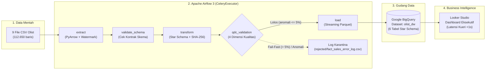
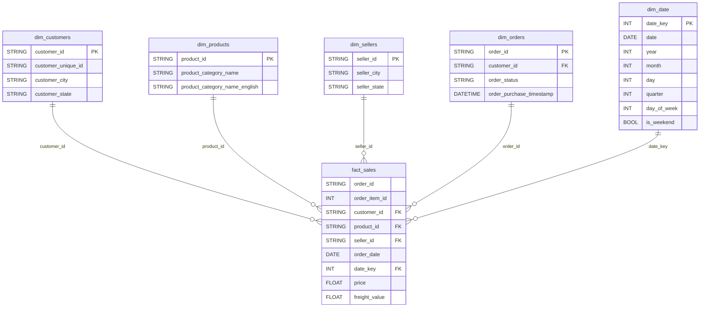

<div align="center">

# Pipeline Rekayasa Data E-Commerce Terotomatisasi
### Arsitektur ELT Cloud-Native dengan Apache Airflow 3, BigQuery, Star Schema Kimball, dan Gerbang Kualitas In-Flight

[](https://airflow.apache.org/)
[](https://cloud.google.com/bigquery)
[](https://www.python.org/)
[](https://www.docker.com/)
[](https://docs.celeryq.dev/)
[](https://lookerstudio.google.com/)
[](https://github.com/virgiawanprima/ecommerce-etl-airflow-bigquery/actions)

<p align="center">
  <b>Pipeline data otomatis berstandar produksi yang memproses 112.650 baris data transaksi e-commerce Olist Brazil ke Google BigQuery menggunakan Star Schema Ralph Kimball, orkestrasi CeleryExecutor Apache Airflow 3, muat inkremental watermark, anonimisasi kriptografis PII SHA-256, dan Quality Gate in-flight 4 dimensi.</b>
</p>

<p align="center">
  <a href="README.md"><b>English Version</b></a> •
  <b>Bahasa Indonesia</b> •
  <a href="#tentang"><b>Tentang</b></a> •
  <a href="#fitur-utama"><b>Fitur Utama</b></a> •
  <a href="#arsitektur-sistem"><b>Arsitektur</b></a> •
  <a href="#pemodelan-data"><b>Pemodelan Data</b></a> •
  <a href="#metrik-dan-benchmark-terverifikasi"><b>Metrik</b></a> •
  <a href="#mulai-cepat"><b>Mulai Cepat</b></a> •
  <a href="#pengujian-dan-verifikasi"><b>Pengujian</b></a>
</p>

</div>

---

## 📋 Daftar Isi

- [📖 Tentang](#tentang)
- [✨ Fitur Utama](#fitur-utama)
- [🏗️ Arsitektur Sistem](#arsitektur-sistem)
- [📊 Pemodelan Data](#pemodelan-data)
- [⚡ Metrik dan Benchmark Terverifikasi](#metrik-dan-benchmark-terverifikasi)
- [🛠️ Tech Stack](#tech-stack)
- [📂 Struktur Repositori](#struktur-repositori)
- [🚀 Mulai Cepat](#mulai-cepat)
- [Demo presentasi](#demo-presentasi)
- [🧪 Pengujian dan Verifikasi](#pengujian-dan-verifikasi)
- [⚙️ Konfigurasi](#konfigurasi)
- [📜 Lisensi dan Konteks Akademik](#lisensi-dan-konteks-akademik)

---

## 📖 Tentang

Proyek ini merekayasa pipeline data ELT terotomatisasi berstandar industri untuk dataset e-commerce Olist Brazil (112.650 baris item pesanan dari 9 tabel relasional sumber rentang 2016 sampai 2018). Pipeline ini mentransformasikan data OLTP ternormalisasi menjadi gudang data analitik di Google BigQuery untuk mendukung dashboard eksekutif Looker Studio dengan latensi kueri di bawah satu detik.

### Masalah Utama yang Diselesaikan

- **Latensi Kueri OLTP 3NF:** Menghilangkan join kompleks 8 tabel relasional melalui pemodelan Star Schema Ralph Kimball (join analitik satu langkah).
- **Kegagalan Ingestion Senyap:** Menerapkan gerbang Quality Dimensions Check (QDC) in-flight dengan ambang batas fail-fast 5%, mencegah data anomali masuk ke data warehouse produksi.
- **Pelanggaran Privasi Data Pribadi:** Melindungi data sensitif pelanggan dengan hashing kriptografis SHA-256 sesuai standar GDPR dan UU PDP No. 27 Tahun 2022.
- **Pemborosan Batch ETL Berulang:** Menerapkan mekanisme muat inkremental berbasis batas air (*watermark*) `MAX(order_date)` dari BigQuery, menghemat transfer data lebih dari 99% pada kondisi stabil.
- **Ketahanan BigQuery Sandbox:** Mengadopsi penyimpanan non-partitioned untuk menghindari penghapusan otomatis data historis setelah 60 hari pada BigQuery Sandbox.

---

## ✨ Fitur Utama

- **Pipeline Modular 5 Task Airflow:** `extract` → `validate_schema` → `transform` → `qdc_validation` → `load`.
- **Quality Gate In-Flight (QDC):** Menguji 4 dimensi (Completeness, Uniqueness, Consistency, Validity). Mengisolasi data anomali ke `data/processed/rejected/` dan membatalkan pipeline jika rasio anomali melebihi 5%.
- **Proteksi PII Zero-Trust:** Pseudonimisasi SHA-256 berentropi tinggi pada `customer_unique_id`.
- **Strategi Muat Hibrida:** Deteksi otomatis antara Full Load (`WRITE_TRUNCATE`) saat gudang data kosong dan Incremental Delta Load (`WRITE_APPEND`) via watermark.
- **Penyimpanan Terpisah 3 Zona:** Alur pemrosesan data lokal terstruktur (`staging/`, `clean/`, `rejected/`).
- **Demo dan tes terisolasi:** Tiga DAG manual menguji data bersih serta skenario di bawah dan di atas ambang QDC tanpa menulis ke dataset dashboard. CI menguji ketiganya dengan data sintetis.

---

## 🏗️ Arsitektur Sistem



### Rincian Task Pipeline

| Task | Lingkup Eksekusi |
| :--- | :--- |
| `extract` | Membaca 9 file CSV via PyArrow tervektorisasi dan mengueri BigQuery untuk watermark `MAX(order_date)`. |
| `validate_schema` | Memvalidasi keberadaan kolom dan kontrak skema; langsung berhenti jika format tidak sesuai. |
| `transform` | Menstandarisasi tipe data, merangkai Star Schema, memfilter delta transaksi, dan melakukan hashing SHA-256 PII. |
| `qdc_validation` | Menguji 4 dimensi kualitas; mengarantina data anomali dan menghentikan pipeline jika error > 5%. |
| `load` | Mengunggah tabel Parquet bersih ke Google BigQuery dengan mekanisme retry berjeda eksponensial. |

---

## 📊 Pemodelan Data

Gudang data mengadopsi Star Schema Ralph Kimball yang terdiri dari 1 tabel fakta transaksi dan 5 tabel dimensi:



| Nama Tabel | Peran | Baris | Kunci Utama / Komposit | Deskripsi Granularitas Data |
| :--- | :--- | :---: | :--- | :--- |
| `fact_sales` | Fakta | 112.650 | `order_id` + `order_item_id` | Setiap item produk dalam pesanan pelanggan |
| `dim_customers` | Dimensi | 99.441 | `customer_id` | Wilayah geografis dan identitas pelanggan ter-hash |
| `dim_products` | Dimensi | 32.951 | `product_id` | Katalog kategori produk (bahasa Portugis dan Inggris) |
| `dim_sellers` | Dimensi | 3.095 | `seller_id` | Wilayah geografis penjual (kota, negara bagian) |
| `dim_orders` | Dimensi | 99.441 | `order_id` | Status siklus pesanan dan stempel waktu pembelian |
| `dim_date` | Dimensi | 634 | `date_key` (YYYYMMDD) | Atribut kalender, kuartal, hari dalam minggu, penanda akhir pekan |

---

## ⚡ Metrik dan Benchmark Terverifikasi

Seluruh metrik berikut bersumber dari log pengujian empiris nyata yang didokumentasikan di [`docs/bab4_hasil_pengujian.md`](docs/bab4_hasil_pengujian.md) dan [`docs/metrik_performa.md`](docs/metrik_performa.md):

| Dimensi Pengujian | Target / Ambang SLA | Hasil Aktual Pengujian | Status |
| :--- | :--- | :--- | :---: |
| **Durasi Pipeline (Muat Penuh)** | < 15 menit (900 detik) | **39 sampai 57 detik** | Lulus |
| **Kelulusan Gerbang Data Bersih** | >= 95,0% lulus | **100,0% lulus** (112.650 baris bersih, 0 anomali lolos) | Lulus |
| **Presisi Deteksi Noise Sintetis** | 100% presisi deteksi | **100,0% presisi** (terdeteksi seluruh 2.252 baris pada uji 2% dan 9.012 baris pada uji 8%) | Lulus |
| **Penerapan Batas Fail-Fast** | Hentikan jika noise > 5% | **Terbukti**: Task `load` diabaikan (`try_number=0`), 0 baris kotor termuat | Lulus |
| **Overhead Komputasi QDC** | Dampak minimal | **+4,55 detik (+7,9%)** penambahan durasi komputasi | Lulus |
| **Anonimisasi Data PII** | Nol kebocoran teks terbaca | **0 data pelanggan terbuka**, 100% hash SHA-256 64 karakter | Lulus |
| **Latensi Kueri Looker Studio** | Interaktif (<3 detik) | **< 1 detik respons kueri** pada Star Schema BigQuery | Lulus |
| **Stabilitas Jadwal Cron** | Deviasi < 5,0% | **+0,6 detik deviasi rata-rata** (+1,0s maks, 0,56% interval) | Lulus |

---

## 🛠️ Tech Stack

| Lapisan | Teknologi | Versi | Peran dan Tanggung Jawab |
| :--- | :--- | :--- | :--- |
| **Orkestrasi** | Apache Airflow | 3.0.6 | Penjadwalan alur kerja terdistribusi dan monitoring (CeleryExecutor) |
| **Data Warehouse** | Google Cloud BigQuery | Cloud-Native | Gudang data analitik kolumnar (dataset: `olist_dw`, lokasi: `asia-southeast2`) |
| **Mesin Pemrosesan** | Python / PyArrow / Pandas | 3.12 / Tervektorisasi | Pemrosesan ETL in-memory, validasi skema, dan join Star Schema |
| **Broker Pesan** | Redis | 7.2 Alpine | Antrean pesan tugas untuk worker terdistribusi Airflow Celery |
| **Penyimpanan Metadata** | PostgreSQL | 16 Alpine | Penyimpanan metadata operasional dan status task Airflow |
| **Kontainerisasi** | Docker Compose | v2+ | 7 layanan mikro terisolasi pada lingkungan lokal / WSL2 |
| **Business Intelligence** | Google Looker Studio | Cloud-Native | Dashboard analitik visual eksekutif interaktif |
| **CI / Otomasi** | GitHub Actions | Ubuntu Latest | Linting otomatis, uji integritas DAG, dan suite pengujian unit |

---

## 📂 Struktur Repositori

```text
ecommerce-etl-airflow-bigquery/
├── .github/workflows/ci.yml       # CI: validasi Compose, build image, lint, dan seluruh tes
├── config/keys/                  # Kredensial GCP Service Account (gcp-sa-key.json diabaikan git)
├── dags/
│   ├── olist_etl_pipeline.py     # DAG utama 5 task dengan integrasi QDC gate
│   ├── olist_etl_baseline_noqdc.py # DAG baseline pembanding tanpa gerbang kualitas
│   └── olist_presentation_demos.py # Tiga DAG presentasi terisolasi
├── data/
│   ├── processed/                # Area pemrosesan data lokal
│   │   ├── clean/                # Berkas Parquet tervalidasi siap muat ke BigQuery
│   │   ├── rejected/             # Berkas karantina anomali (fact_sales_error_log.csv)
│   │   └── staging/              # Pementasan ekstraksi dan tabel Star Schema
│   └── raw/                      # 9 berkas CSV mentah Olist (diabaikan git)
├── docs/                         # Dokumentasi riset skripsi dan laporan benchmark lengkap
├── src/
│   ├── scripts/
│   │   └── noise_injection.py    # Skrip injeksi anomali sintetis untuk pengujian fail-fast
│   └── utils/
│       ├── io_helpers.py         # Utilitas I/O tervektorisasi dengan perutean subdirektori
│       ├── pii.py                # Enkripsi hashing SHA-256 pelindungan data pribadi
│       ├── qdc.py                # Mesin validasi Quality Dimensions Check 4 dimensi
│       └── self_check.py         # Suite pengujian unit 19 assertion logika sistem
├── tests/
│   ├── test_airflow_dags.py       # Impor dan dependensi task pada lima DAG
│   ├── test_presentation_demos.py # Hasil demo dan isolasi dataset
│   └── test_qdc_boundary.py      # Pengujian unit kondisi batas fail-fast QDC
├── docker-compose.yml            # 7 layanan mikro Airflow (Webserver, Scheduler, Worker, Redis, Postgres)
├── Dockerfile                    # Image Apache Airflow 3.0.6 kustom dengan dependensi GCP
├── Makefile                      # Perintah CLI standar untuk cek, eksekusi, dan verifikasi
├── requirements.txt              # Pustaka dependensi Python
└── .env.example                  # Template konfigurasi variabel lingkungan
```

---

## 🚀 Mulai Cepat

### Prasyarat
- Docker Engine 24+ dan Docker Compose v2+ (didukung penuh via WSL2 di Windows).
- Akun Google Cloud Platform dengan hak akses BigQuery Admin atau Data Editor.
- 9 berkas CSV mentah Olist ditempatkan pada direktori `data/raw/`.

### 1. Konfigurasi Lingkungan dan Kredensial
```bash
cp .env.example .env
# Sesuaikan GCP_PROJECT_ID, BIGQUERY_DATASET, dan BIGQUERY_LOCATION di .env

# Tempatkan berkas kredensial Service Account JSON GCP:
cp /path/ke/kunci-gcp.json config/keys/gcp-sa-key.json
```

### 2. Jalankan Layanan Kontainer Airflow
```bash
docker compose up -d
```
*Akses antarmuka web Airflow di `http://localhost:8080` (Kredensial bawaan: `airflow` / `airflow`).*

### 3. Picu Eksekusi Pipeline
Untuk presentasi, gunakan [demo terisolasi](#demo-presentasi). Perintah di bawah memicu DAG utama yang menulis ke dataset sesuai `BIGQUERY_DATASET`.

```bash
docker compose exec airflow-scheduler airflow dags trigger olist_etl_pipeline
# Atau gunakan Makefile:
make run
```

---

## Demo presentasi

Jalankan stack Compose dari direktori repositori. Menyalakan Docker saja belum menjalankan Airflow. Di Windows, jika Docker tersedia melalui Ubuntu WSL, jalankan perintah Compose yang sama dari Ubuntu. Buka [Airflow](http://127.0.0.1:8080), filter tag `demo`, lalu klik **Trigger DAG**. Tidak perlu mengisi parameter atau menyuntikkan noise secara manual.

| DAG | Hasil yang diharapkan |
| :--- | :--- |
| `demo_pipeline` | Semua task sukses. Memuat 112.650 baris fakta ke `olist_demo_pipeline`. |
| `demo_noise-2` | QDC menolak 2.252 baris dan memuat 110.398 baris valid ke `olist_demo_noise_2`. |
| `demo_noise-8` | QDC menolak 9.012 baris, melebihi ambang 5%. Run memang gagal: `load` berstatus `upstream_failed` dan dataset tidak dibuat. |

Angka tersebut berasal dari gladi dengan data Olist lengkap. Setiap run memakai direktori staging sendiri. Injeksi noise hanya mengubah salinan, dan DAG demo tidak menulis ke `olist_dw`. Dua skenario yang memuat data membutuhkan internet dan kredensial BigQuery yang dapat membuat serta menulis ke dataset demo.

Untuk menjelaskan hasil, buka **Graph** dan log `qdc_validation`. Jika koneksi bermasalah, buka riwayat gladi pada Airflow lokal jika masih tersedia. Semua DAG saat ini bersifat manual (`schedule=None`) dan belum mendukung backfill historis. DAG utama memakai watermark gudang data, sedangkan demo membaca snapshot penuh, bukan interval data Airflow.

---

## 🧪 Pengujian dan Verifikasi

[GitHub Actions](https://github.com/virgiawanprima/ecommerce-etl-airflow-bigquery/actions/workflows/ci.yml) memvalidasi Compose, membangun image Airflow, memeriksa dependensi dan lint, lalu menjalankan `self_check.py` dan seluruh suite `pytest`. [Run CI yang diverifikasi](https://github.com/virgiawanprima/ecommerce-etl-airflow-bigquery/actions/runs/44485935390) meluluskan 19 tes, 6 subtes, dan 19 pemeriksaan mandiri.

CI memeriksa kelima DAG serta menjalankan ketiga demo dengan data sintetis dan tiruan klien BigQuery di kontainer tanpa jaringan. CI tidak menguji login browser, stack Celery aktif, atau akses BigQuery asli. Untuk memeriksanya, lakukan gladi di mesin presentasi.

Untuk pemeriksaan operasional lokal pada stack aktif dan dataset BigQuery yang dikonfigurasi:

```bash
make verify    # Menjalankan dag-check, self-check, dan verifikasi jumlah baris BigQuery
```

| Perintah | Cakupan Verifikasi |
| :--- | :--- |
| `make check` | Menjalankan target `dag-check` dan `self-check`. |
| `make dag-check` | Memvalidasi sintaks Python, registrasi 5 task DAG, dan pohon dependensi pip. |
| `make self-check` | Menjalankan 19 unit test assert untuk logika QDC, batas fail-fast, dan hash SHA-256. |
| `make bq-verify` | Mengueri BigQuery langsung untuk memastikan jumlah baris 6 tabel Star Schema sesuai. |
| `make run-baseline` | Memicu DAG baseline tanpa QDC untuk mengukur perbandingan durasi eksekusi. |

### Kueri Verifikasi BigQuery Langsung
```sql
SELECT 
    COUNT(*) AS total_sales_records,
    COUNT(DISTINCT order_id) AS total_orders,
    ROUND(SUM(price), 2) AS total_gross_revenue_brl
FROM `your-gcp-project.olist_dw.fact_sales`;
-- Target Hasil: 112.650 baris | 98.666 pesanan unik | R$ 13.591.643,70 gross revenue
```

---

## ⚙️ Konfigurasi

Variabel lingkungan utama yang didefinisikan pada `.env.example`:

| Variabel | Nilai Bawaan | Keterangan |
| :--- | :--- | :--- |
| `AIRFLOW_UID` | `50000` | POSIX UID untuk proses kontainer Airflow. |
| `_AIRFLOW_WWW_USER_USERNAME` | `airflow` | Nama pengguna bawaan untuk Web UI Airflow. |
| `_AIRFLOW_WWW_USER_PASSWORD` | `airflow` | Kata sandi bawaan untuk Web UI Airflow. |
| `GCP_PROJECT_ID` | `your-gcp-project-id` | ID Proyek Google Cloud tempat BigQuery berada. |
| `BIGQUERY_DATASET` | `olist_dw` | Nama dataset target untuk tabel Star Schema. |
| `BIGQUERY_LOCATION` | `asia-southeast2` | Wilayah komputasi geografis BigQuery (Jakarta). |

---

## 📜 Lisensi dan Konteks Akademik

- **Konteks Akademik:** Dikembangkan dan divalidasi sebagai implementasi teknis untuk penelitian skripsi di **Politeknik Negeri Samarinda (2026)**.
- **Atribusi Dataset:** Brazilian E-Commerce Public Dataset oleh [Olist](https://www.kaggle.com/datasets/olistbr/brazilian-ecommerce) di Kaggle.
- **Dokumentasi Lengkap:** Analisis mendalam trade-off arsitektur, laporan pengujian bab 4, dan evaluasi teknis tersedia di folder [`docs/`](docs/).
- **Lisensi:** Berlisensi sumber terbuka di bawah [MIT License](LICENSE).

<div align="center">
  <sub>Dibangun dengan dedikasi tinggi pada kode bersih, dampak teknis terverifikasi, dan standar keandalan data enterprise.</sub>
</div>
