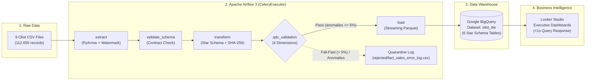
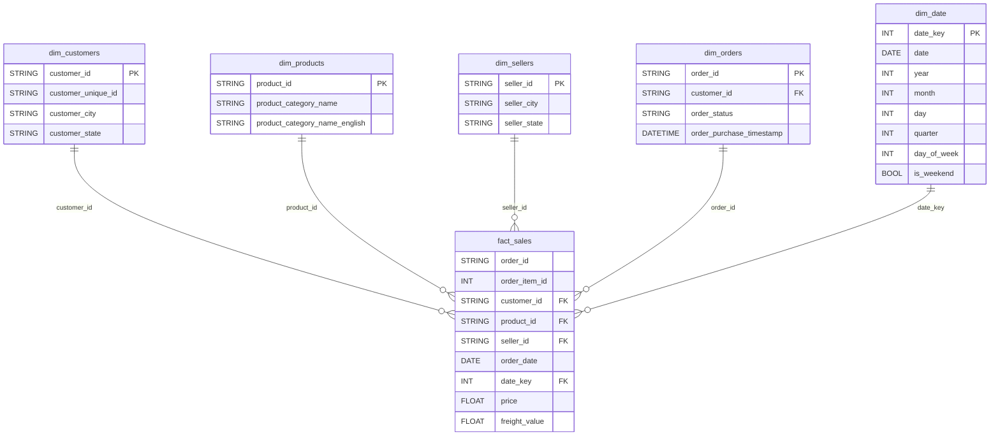

<div align="center">

# Enterprise E-Commerce Automated Data Pipeline
### Cloud-Native ELT Pipeline with Apache Airflow 3, BigQuery, Kimball Star Schema, and In-Flight Quality Gate

[](https://airflow.apache.org/)
[](https://cloud.google.com/bigquery)
[](https://www.python.org/)
[](https://www.docker.com/)
[](https://docs.celeryq.dev/)
[](https://lookerstudio.google.com/)
[](https://github.com/virgiawanprima/ecommerce-etl-airflow-bigquery/actions)

<p align="center">
  <b>Production-grade automated data pipeline processing 112,650 Brazilian Olist e-commerce transaction records into Google BigQuery using Ralph Kimball Star Schema, Apache Airflow 3 CeleryExecutor, watermark incremental loading, cryptographic SHA-256 PII protection, and an in-flight 4-dimensional Quality Gate.</b>
</p>

<p align="center">
  <b>English</b> •
  <a href="README.id.md"><b>Bahasa Indonesia</b></a> •
  <a href="#about"><b>About</b></a> •
  <a href="#key-features"><b>Key Features</b></a> •
  <a href="#system-architecture"><b>Architecture</b></a> •
  <a href="#data-modeling"><b>Data Modeling</b></a> •
  <a href="#verified-metrics--benchmarks"><b>Metrics</b></a> •
  <a href="#quickstart"><b>Quickstart</b></a> •
  <a href="#verification--testing"><b>Testing</b></a>
</p>

</div>

---

## 📋 Table of Contents

- [📖 About](#about)
- [✨ Key Features](#key-features)
- [🏗️ System Architecture](#system-architecture)
- [📊 Data Modeling](#data-modeling)
- [⚡ Verified Metrics & Benchmarks](#verified-metrics--benchmarks)
- [🛠️ Tech Stack](#tech-stack)
- [📂 Project Structure](#project-structure)
- [🚀 Quickstart](#quickstart)
- [Presentation demos](#presentation-demos)
- [🧪 Verification & Testing](#verification--testing)
- [⚙️ Configuration](#configuration)
- [📜 License & Academic Context](#license--academic-context)

---

## 📖 About

This project engineers an enterprise-grade, automated ELT data pipeline for the Brazilian Olist e-commerce dataset (112,650 order items across 9 relational source tables spanning 2016–2018). It transforms fragmented OLTP data into an analytical data warehouse hosted on Google BigQuery, powering executive Looker Studio dashboards with sub-second query latency.

### Core Problems Solved

- **OLTP 3NF Latency:** Eliminates 8-way relational joins by modeling data into a Ralph Kimball Star Schema (single-hop analytical joins).
- **Silent Ingestion Failures:** Enforces an in-flight Quality Dimensions Check (QDC) gate with a 5% fail-fast threshold, preventing dirty records from reaching production.
- **PII Privacy Violations:** Irreversibly hashes customer identities with SHA-256 to comply with GDPR and Indonesia UU PDP (No. 27/2022).
- **Batch Re-ingestion Waste:** Implements watermark-based incremental loading using `MAX(order_date)` from BigQuery, reducing delta data transfer by >99% during steady runs.
- **BigQuery Sandbox Durability:** Operates on non-partitioned storage to bypass the BigQuery Sandbox 60-day partition expiration limit without paid cloud billing.

---

## ✨ Key Features

- **5-Task Modular Airflow DAG:** `extract` → `validate_schema` → `transform` → `qdc_validation` → `load`.
- **In-Flight Quality Gate (QDC):** Evaluates Completeness, Uniqueness, Consistency, and Validity. Quarantines invalid records to `data/processed/rejected/` and aborts the pipeline if anomalies exceed 5%.
- **Zero-Trust PII Protection:** High-entropy SHA-256 pseudonymization on `customer_unique_id`.
- **Hybrid Load Strategy:** Automatic detection between Full Load (`WRITE_TRUNCATE`) on an empty warehouse and Incremental Delta Load (`WRITE_APPEND`) via high-watermark querying.
- **Decoupled 3-Tier Storage:** Structured local processing pipeline (`staging/`, `clean/`, `rejected/`).
- **Isolated demos and tests:** Four manual demo DAGs exercise clean data, the QDC threshold, and incremental loading without writing to the dashboard dataset. CI tests these scenarios with synthetic data.

---

## 🏗️ System Architecture



### Pipeline Tasks

| Task | Execution Scope |
| :--- | :--- |
| `extract` | Reads 9 CSV files via vectorized PyArrow and queries BigQuery for `MAX(order_date)`. |
| `validate_schema` | Validates column presence and schema contracts; halts immediately if malformed. |
| `transform` | Applies date parsing, Star Schema joins, delta filtering, and SHA-256 PII hashing. |
| `qdc_validation` | Evaluates 4 quality dimensions; quarantines bad records and halts if anomaly rate > 5%. |
| `load` | Loads clean Parquet tables into Google BigQuery with exponential retry backoff. |

---

## 📊 Data Modeling

The data warehouse uses a Ralph Kimball Star Schema with 1 centralized fact table and 5 conformed dimension tables:



| Table Name | Type | Records | Primary / Composite Key | Grain Description |
| :--- | :--- | :---: | :--- | :--- |
| `fact_sales` | Fact | 112,650 | `order_id` + `order_item_id` | Individual item within a customer order |
| `dim_customers` | Dimension | 99,441 | `customer_id` | Customer location and SHA-256 hashed identity |
| `dim_products` | Dimension | 32,951 | `product_id` | Product catalog categories (PT and EN) |
| `dim_sellers` | Dimension | 3,095 | `seller_id` | Merchant geographic location |
| `dim_orders` | Dimension | 99,441 | `order_id` | Order status and lifecycle purchase timestamp |
| `dim_date` | Dimension | 634 | `date_key` (YYYYMMDD) | Calendar attributes, quarter, day of week, weekend flag |

---

## ⚡ Verified Metrics & Benchmarks

All metrics below are derived from empirical test runs documented in [`docs/bab4_hasil_pengujian.md`](docs/bab4_hasil_pengujian.md) and [`docs/metrik_performa.md`](docs/metrik_performa.md):

| Dimension | Target / SLA | Verified Result | Status |
| :--- | :--- | :--- | :---: |
| **Pipeline Duration (Full Load)** | < 15 min (900s) | **39 – 57 seconds** | Passed |
| **Clean Data Quality Gate** | >= 95.0% pass | **100.0% pass** (112,650 clean records, 0 unhandled anomalies) | Passed |
| **Synthetic Noise Detection** | 100% precision | **100.0% precision** (detected all 2,252 rows in 2% test and 9,012 rows in 8% test) | Passed |
| **Fail-Fast Enforcement** | Abort if noise > 5% | **Verified**: `load` task skipped (`try_number=0`), 0 bad records loaded | Passed |
| **QDC Engine Overhead** | Minimal impact | **+4.55s (+7.9%)** computational overhead | Passed |
| **PII Anonymization** | Zero plaintext leaks | **0 plaintext customer IDs**, 100% SHA-256 64-char hashes | Passed |
| **Looker Studio BI Latency** | Interactive (<3s) | **< 1s query response** on BigQuery Star Schema | Passed |
| **Scheduler Stability** | Deviation < 5.0% | **+0.6s average deviation** (+1.0s max, 0.56% of interval) | Passed |

---

## 🛠️ Tech Stack

| Layer | Technology | Version | Purpose |
| :--- | :--- | :--- | :--- |
| **Orchestration** | Apache Airflow | 3.0.6 | Distributed workflow scheduling and monitoring (CeleryExecutor) |
| **Data Warehouse** | Google Cloud BigQuery | Cloud-Native | Columnar data warehouse (dataset: `olist_dw`, region: `asia-southeast2`) |
| **Processing Engine** | Python / PyArrow / Pandas | 3.12 / Vectorized | In-memory ETL processing, schema validation, and Star Schema joins |
| **Message Broker** | Redis | 7.2 Alpine | Task queue backend for Airflow Celery workers |
| **Metadata Store** | PostgreSQL | 16 Alpine | Airflow operational metadata and task state tracking |
| **Containerization** | Docker Compose | v2+ | 7 isolated microservices running in local / WSL2 environment |
| **Business Intelligence** | Google Looker Studio | Cloud-Native | Interactive executive reporting dashboards |
| **CI / Automation** | GitHub Actions | Ubuntu Latest | Automated linting, DAG integrity check, and unit test suites |

---

## 📂 Project Structure

```text
ecommerce-etl-airflow-bigquery/
├── .github/workflows/ci.yml       # CI: Compose validation, image build, lint, and full test suite
├── config/keys/                  # GCP service account credentials (gcp-sa-key.json gitignored)
├── dags/
│   ├── olist_etl_pipeline.py     # Production 5-task ELT DAG with integrated QDC gate
│   ├── olist_etl_baseline_noqdc.py # Benchmark baseline DAG without quality gate
│   └── olist_presentation_demos.py # Four isolated presentation DAGs
├── data/
│   ├── processed/                # Local runtime data processing
│   │   ├── clean/                # Validated Parquet files ready for BigQuery
│   │   ├── rejected/             # Quarantined anomaly logs (fact_sales_error_log.csv)
│   │   └── staging/              # Intermediate extraction and Star Schema staging
│   └── raw/                      # 9 raw Olist CSV source datasets (gitignored)
├── docs/                         # Extended thesis documentation and benchmark reports
├── src/
│   ├── scripts/
│   │   └── noise_injection.py    # Synthetic anomaly injector for fail-fast validation
│   └── utils/
│       ├── io_helpers.py         # Vectorized I/O routines with subdirectory routing
│       ├── pii.py                # SHA-256 cryptographic PII pseudonymization
│       ├── qdc.py                # 4-dimensional Quality Dimensions Check engine
│       └── self_check.py         # 19-assertion unit verification suite
├── tests/
│   ├── test_airflow_dags.py       # Imports and task dependencies for all six DAGs
│   ├── test_presentation_demos.py # Demo behavior and dataset isolation
│   └── test_qdc_boundary.py      # Unit tests for QDC fail-fast boundary logic
├── docker-compose.yml            # 7 Airflow services (Webserver, Scheduler, Worker, Redis, Postgres)
├── Dockerfile                    # Custom Airflow 3.0.6 image with GCP dependencies
├── Makefile                      # Standard CLI shortcuts for checking, running, and verifying
├── requirements.txt              # Pinned Python package dependencies
└── .env.example                  # Environment configuration template
```

---

## 🚀 Quickstart

### Prerequisites
- Docker Engine 24+ & Docker Compose v2+ (WSL2 supported on Windows).
- Google Cloud Platform account with BigQuery Admin / Data Editor access.
- 9 raw Olist CSV files placed in `data/raw/`.

### 1. Setup Environment & Credentials
```bash
cp .env.example .env
# Edit .env: set GCP_PROJECT_ID, BIGQUERY_DATASET, and BIGQUERY_LOCATION

# Place your GCP Service Account JSON key:
cp /path/to/your-key.json config/keys/gcp-sa-key.json
```

### 2. Launch Airflow Infrastructure
```bash
docker compose up -d
```
*Access Airflow Web UI at `http://localhost:8080` (Credentials: `airflow` / `airflow`).*

### 3. Run Pipeline
For a presentation, use the [isolated demos](#presentation-demos). The command below triggers the main DAG, which writes to the dataset configured by `BIGQUERY_DATASET`.

```bash
docker compose exec airflow-scheduler airflow dags trigger olist_etl_pipeline
# Or simply:
make run
```

---

## Presentation demos

Start the Compose stack from the repository root, not just Docker. On Windows with Docker available inside Ubuntu WSL, run the same Compose command inside Ubuntu. Open [Airflow](http://127.0.0.1:8080), filter by the `demo` tag, and click **Trigger DAG**. No run parameters or manual noise injection are needed.

| DAG | Expected result |
| :--- | :--- |
| `demo_pipeline` | All tasks succeed. Loads 112,650 fact rows into `olist_demo_pipeline`. |
| `demo_noise-2` | QDC rejects 2,252 rows and loads 110,398 valid rows into `olist_demo_noise_2`. |
| `demo_noise-8` | QDC rejects 9,012 rows, above the 5% threshold. QDC retries three times at five-minute intervals, then the run fails and `load` is `upstream_failed`. This run does not create or load a dataset. |
| `demo_incremental` | Uses the `olist_demo_incremental` dataset to demonstrate an initial load, a watermark-based append, and a skipped load when no new fact rows are available. |

The counts for the three snapshot demos come from the rehearsal with the full Olist input. Each run uses its own staging directory. Noise affects only a copy, and the demo DAGs do not write to `olist_dw` or the dataset configured as `BIGQUERY_DATASET`. Scenarios that load data require internet access and BigQuery credentials that can create and write to the demo datasets.

New demo datasets default to tables expiring 60 days after creation. Changing a dataset's default does not change the expiration of existing tables.

To demonstrate `demo_incremental`, trigger the DAG multiple times with the same input:

1. If `olist_demo_incremental.fact_sales` is missing or empty, the first run loads an initial batch through the middle date in the sorted list of unique transaction dates using `WRITE_TRUNCATE`. The input must contain transactions on at least two dates.
2. The next run reads `MAX(order_date)` as the watermark and appends newer fact rows with `WRITE_APPEND`. It reloads the dimension tables.
3. If there are no new fact rows and QDC passes, the `load` task skips all table loads. If the fact table already contains data before the demo, the run uses its existing watermark instead of repeating the initial batch.

The filter selects dates greater than the watermark. Transactions arriving late on or before the watermark date can be missed. To explain the outcome, open **Graph** and the `extract`, `transform`, `qdc_validation`, and `load` logs. All DAGs are manual (`schedule=None`) and do not support historical backfill. The three snapshot demos process the full input, while `demo_incremental` filters fact rows by watermark rather than by the Airflow data interval.

---

## 🧪 Verification & Testing

[GitHub Actions](https://github.com/virgiawanprima/ecommerce-etl-airflow-bigquery/actions/workflows/ci.yml) validates Compose, builds the Airflow image, checks dependencies and lint, and runs `self_check.py` and the full `pytest` suite. A [previous verified CI run](https://github.com/virgiawanprima/ecommerce-etl-airflow-bigquery/actions/runs/44485935390) passed 19 tests, 6 subtests, and 19 self-checks.

CI checks six DAGs and runs four demos with synthetic input and a mocked BigQuery client in a network-disabled container. It does not test browser login, the live Celery stack, or BigQuery access. Rehearse on the presentation machine for those checks.

For local operational checks against the running stack and the configured BigQuery dataset:

```bash
make verify    # Runs dag-check, self-check, and live BigQuery row count verification
```

| Command | Verification Scope |
| :--- | :--- |
| `make check` | Runs both `dag-check` and `self-check`. |
| `make dag-check` | Verifies Python syntax, 5-task DAG registration, and pip dependency tree. |
| `make self-check` | Executes 19 assert-based unit tests for QDC logic, fail-fast boundary, and SHA-256. |
| `make bq-verify` | Queries BigQuery directly to verify row counts across all 6 Star Schema tables. |
| `make run-baseline` | Runs the baseline pipeline without QDC to measure runtime differences. |

### BigQuery Live Verification Query
```sql
SELECT 
    COUNT(*) AS total_sales_records,
    COUNT(DISTINCT order_id) AS total_orders,
    ROUND(SUM(price), 2) AS total_gross_revenue_brl
FROM `your-gcp-project.olist_dw.fact_sales`;
-- Expected Target: 112,650 rows | 98,666 unique orders | R$ 13,591,643.70 gross revenue
```

---

## ⚙️ Configuration

Key environment variables defined in `.env.example`:

| Variable | Default Value | Description |
| :--- | :--- | :--- |
| `AIRFLOW_UID` | `50000` | POSIX UID for Airflow container processes. |
| `_AIRFLOW_WWW_USER_USERNAME` | `airflow` | Default Airflow Web UI administrator username. |
| `_AIRFLOW_WWW_USER_PASSWORD` | `airflow` | Default Airflow Web UI administrator password. |
| `GCP_PROJECT_ID` | `your-gcp-project-id` | Google Cloud project hosting BigQuery. |
| `BIGQUERY_DATASET` | `olist_dw` | Target dataset name for the Star Schema warehouse. |
| `BIGQUERY_LOCATION` | `asia-southeast2` | Geographic compute region for BigQuery tables. |

---

## 📜 License & Academic Context

- **Academic Context:** Developed as the technical implementation for an undergraduate engineering thesis at **Politeknik Negeri Samarinda (2026)**.
- **Dataset Attribution:** Brazilian E-Commerce Public Dataset by [Olist](https://www.kaggle.com/datasets/olistbr/brazilian-ecommerce) on Kaggle.
- **Detailed Documentation:** In-depth architectural trade-offs, testing results, and evaluation responses are documented in [`docs/`](docs/).
- **License:** Open-source under the [MIT License](LICENSE).

<div align="center">
  <sub>Engineered with rigorous adherence to clean code, verifiable technical impact, and enterprise data reliability standards.</sub>
</div>
