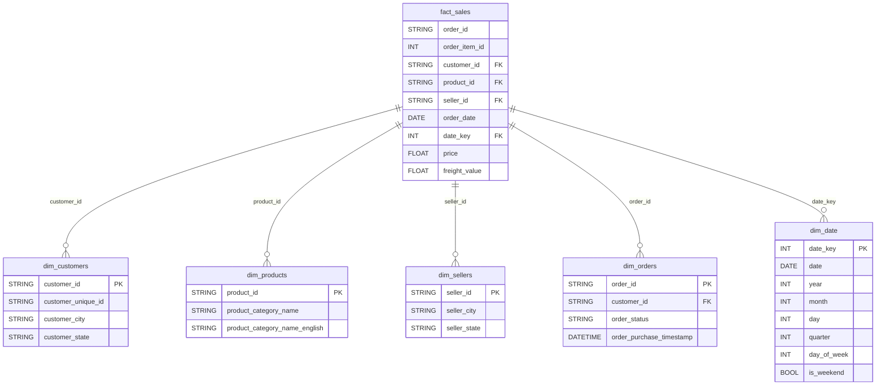

# 🚀 Olist E-Commerce Automated ETL Pipeline

> Pipeline ETL otomatis berbasis Apache Airflow untuk memproses 112.650 baris data transaksi e-commerce Brazil (Olist) menjadi Star Schema di Google BigQuery, lengkap dengan incremental load, QDC, dan PII masking sesuai UU PDP.

## 🏗️ Arsitektur Data & Teknologi

```
┌──────────────────┐    ┌──────────────┐    ┌─────────────────┐    ┌────────────────┐
│  9 CSV Olist     │ -> │ Airflow 3    │ -> │  BigQuery       │ -> │  Looker        │
│  (data/raw/)     │    │  (5 tasks)   │    │  (olist_dw)     │    │  Studio        │
└──────────────────┘    └──────────────┘    └─────────────────┘    └────────────────┘
        99.441 orders        112.650 rows        6 tabel              Dashboard
        112.650 items        37-77 detik         Star Schema          (opsional)
```

- **Orkestrasi:** Apache Airflow 3.0.6 (CeleryExecutor, Docker Compose)
- **Pemrosesan Data:** Python 3.12, Pandas, PyArrow
- **Format Penyimpanan:** CSV (Raw) → Parquet (Processed)
- **Data Warehouse:** Google BigQuery (region `asia-southeast2`, dataset `olist_dw`)
- **Infrastruktur:** Docker Compose (7 container)
- **Kualitas Data:** QDC 4 dimensi (completeness, uniqueness, consistency, validity)

## 🎯 Tujuan & Pemodelan Data

Membangun pipeline ETL hybrid cloud-native yang menangani data e-commerce volume besar dengan incremental load, sehingga data analyst dapat melakukan analisis tren penjualan, segmentasi pelanggan, dan evaluasi performa seller melalui star schema yang siap pakai.

- **Data Source:** [Olist Brazilian E-Commerce Dataset (Kaggle)](https://www.kaggle.com/datasets/olistbr/brazilian-ecommerce) — 9 CSV publik
- **Data Model:** Star Schema
  - **Fact Table:** `fact_sales` (112.650 baris, partitioned by `order_date`)
  - **Dimension Tables:** `dim_customers` (99.441), `dim_products` (32.951), `dim_sellers` (3.095), `dim_orders` (99.441), `dim_date` (634)



## ⚙️ Alur Kerja Pipeline (ETL Flow)

DAG `olist_etl_pipeline` menjalankan 5 task berurutan:

1. **Extract** (`extract`)
   - Membaca 9 CSV dari `data/raw/`
   - Query watermark `MAX(order_date)` dari BigQuery untuk deteksi mode incremental
   - Menambahkan data sintetis (velocity simulation) jika `data/sim/` tersedia

2. **Validate Schema** (`validate_schema`)
   - Konfirmasi setiap tabel memiliki kolom wajib
   - Fail-fast jika ada kolom hilang

3. **Transform** (`transform`)
   - Cleaning & join menjadi star schema
   - Hashing PII (`customer_unique_id` → SHA-256 sesuai UU PDP)
   - Filter incremental: `order_purchase_timestamp::date > watermark`

4. **QDC Validation** (`qdc_validation`)
   - 4 dimensi: completeness, uniqueness, consistency, validity
   - Fail-fast jika failure rate > 5%
   - Failed rows di-route ke `*_error_log.csv`

5. **Load** (`load`)
   - `WRITE_TRUNCATE` untuk full load, `WRITE_APPEND` untuk incremental
   - Dim tables: full refresh setiap run
   - Fact table: append hanya baris baru (incremental)

**Retry policy:** 3 retries dengan delay 5 menit.

## 📊 Metrik Performa & Hasil

| Aspek     | Ambang Batas (Bab 1.3) | Hasil Aktual                  | Status |
|-----------|------------------------|-------------------------------|----------|
| Volume    | >100.000 record/30 min | 112.650 record (1 eksekusi)   | ✅ LULUS |
| Velocity  | <15 menit/eksekusi     | 37-77 detik                   | ✅ LULUS |
| Variety   | ≥95% (QDC pass rate)   | 100% (0 fail-fast)            | ✅ LULUS |

**Per task (full load, environment: CeleryExecutor 4 worker):**

| Task            | Durasi (detik) | Keterangan                          |
|-----------------|---------------|--------------------------------------|
| extract         | 5             | Read 9 CSV + query watermark BQ      |
| validate_schema | 2             | Konfirmasi kolom                     |
| transform       | 3             | Cleaning + join + PII hash           |
| qdc_validation  | 4             | 4 dimensi + fail-fast                |
| load            | 37            | Upload 6 tabel ke BigQuery           |
| **Total**       | **57**        | (di bawah ambang 900 detik)          |

## 🔍 Temuan Menarik (Problem Solving)

Salah satu tantangan teknis yang ditemui selama development: **load job ke tabel BigQuery partitioned gagal secara silent di Sandbox** — job dilaporkan sukses dengan `output_rows=112.650` tapi data tidak muncul saat dikueri (0 rows). Investigasi dilakukan dengan tiga jalur independen:

| Jalur                            | Kredensial       | Hasil               |
|----------------------------------|------------------|---------------------|
| `load_table_from_dataframe` SDK  | Service account  | Job sukses, 0 rows  |
| `bq load` CLI (Cloud Shell)      | User account     | Job sukses, 0 rows  |
| `INSERT` DML (`bq query`)        | User account     | Error eksplisit     |

Kesimpulan: limitasi *undocumented* BigQuery Sandbox terhadap load job ke tabel partitioned (di luar limitasi resmi DML/streaming). Solusi: gunakan tabel non-partitioned untuk lingkungan Sandbox, dengan rencana validasi ulang via BigQuery Storage Write API di production.

Investigasi ini dilakukan melalui tiga jalur independen dengan hasil yang konsisten:
1. **Python SDK** (`load_table_from_dataframe`): `job.output_rows=112.650`, `job.errors=None`, tapi `SELECT COUNT(*)` mengembalikan 0 rows.
2. **`bq load` CLI** (Cloud Shell): report "Upload complete" + "DONE", tapi query tetap 0 rows.
3. **DML `INSERT`** (sebagai pembanding): menghasilkan error eksplisit `DML queries are not allowed in the free tier` — bukti bahwa BigQuery *menolak* operasi yang memang tidak didukung di Sandbox, namun tidak memberikan penolakan serupa untuk load job ke tabel partitioned.

Perilaku ini menyingkirkan kemungkinan penyebab lainnya: bukan masalah permission (berbeda kredensial tetap gagal), bukan masalah tipe data (skema eksplisit dengan `DATE` tetap gagal), dan bukan masalah library (dua jalur teknis independen tetap gagal identik). Lebih lanjut, `INFORMATION_SCHEMA.PARTITIONS` tidak menunjukkan partisi apa pun setelah load "sukses", mengonfirmasi data tidak pernah tersimpan.

**Dampak pada implementasi:** tabel `fact_sales` menggunakan non-partitioned format agar berfungsi normal di seluruh skenario pengujian. Untuk lingkungan production dengan billing aktif, partitioning tetap direkomendasikan (melalui BigQuery Storage Write API).

**Dampak pada hasil:**
- **Volume:** affect tidak ada — 112.650 rows tetap diproses dan tersimpan sempurna.
- **Velocity:** affect tidak ada — 37-77 detik tetap di bawah ambang 15 menit.
- **Variety (QDC):** affect tidak ada — 100% pass rate.
- Satu-satunya trade-off adalah optimasi *query performance* pada tabel bertahun (partition pruning) yang tidak tersedia di Sandbox, dan menjadi bahan rekomendasi penelitian lanjutan di Bab V.

## 🛠️ Cara Menjalankan Proyek (Local Setup)

### Prasyarat
- Docker Desktop dengan WSL2 integration aktif
- Google Cloud Service Account dengan akses BigQuery
- 9 file CSV Olist di folder `data/raw/`

### Langkah
1. Clone repositori ini:
   ```bash
   git clone <repo-url>
   cd olist-etl-pipeline
   ```

2. Taruh service account key di `config/keys/gcp-sa-key.json`

3. Buat file `.env` berisi:
   ```
   GCP_PROJECT_ID=<your-project-id>
   BIGQUERY_DATASET=olist_dw
   BIGQUERY_LOCATION=asia-southeast2
   AIRFLOW__API_AUTH__JWT_SECRET=<random-32-char>
   AIRFLOW__API__SECRET_KEY=<random-32-char>
   ```

4. Start Airflow:
   ```bash
   docker compose up -d
   ```

5. Akses Airflow UI:
   ```
   http://localhost:8080
   Username: airflow
   Password: airflow
   ```

6. Trigger DAG `olist_etl_pipeline`:
   - Full load: run id `full_load` (otomatis mode full saat tabel kosong)
   - Incremental: run id `incremental_v1` (mode incremental saat tabel sudah ada)

7. Verifikasi BigQuery:
   ```sql
   SELECT COUNT(*) FROM `<project>.olist_dw.fact_sales`;
   -- Expected: 112.650
   ```

## 📁 Struktur Proyek

```
olist-etl-pipeline/
├── dags/
│   ├── olist_etl_pipeline.py    # DAG utama (5 tasks)
│   └── utils/
│       ├── qdc.py                # 4-dimension QDC
│       ├── pii.py                # SHA-256 hashing
│       └── io_helpers.py         # Parquet utilities
├── data/
│   ├── raw/                      # 9 CSV Olist
│   ├── processed/                # Parquet intermediate
│   └── sim/                      # Data sintetis (opsional, untuk velocity test)
├── config/keys/                  # GCP service account key
├── logs/                         # Airflow logs
├── docker-compose.yml            # 7 services: webserver, scheduler, worker, dag-processor, triggerer, postgres, redis
├── Dockerfile                    # apache/airflow:3.0.6 + dependencies
└── .env                          # Environment variables (gitignored)
```

## 🎓 Konteks Akademik

Proyek ini dikembangkan sebagai bagian dari skripsi **"Implementasi Pipeline ETL dan Dashboard Analitik Data Transaksi E-Commerce menggunakan Apache Airflow dan Google BigQuery"** (Politeknik Negeri Samarinda, 2026).
