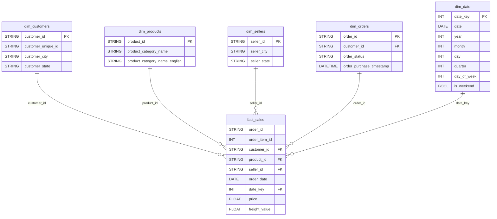

<div align="center">

# 🚀 Olist E-Commerce Automated ETL Pipeline
### Cloud-Native Data Warehouse & Automated Data Quality Control

[](https://airflow.apache.org/)
[](https://cloud.google.com/bigquery)
[](https://www.python.org/)
[](https://www.docker.com/)
[](https://docs.celeryq.dev/)
[](https://lookerstudio.google.com/)

<p align="center">
  <b>Pipeline ETL otomatis berstandar enterprise untuk memproses 112.650 baris data transaksi e-commerce Brazil (Olist) ke Google BigQuery dalam arsitektur Star Schema, dilengkapi orkestrasi Airflow 3, incremental load via watermark, perlindungan privasi data PII SHA-256 (UU PDP), dan gerbang Quality Control 4-Dimensi.</b>
</p>

<p align="center">
  <a href="#-arsitektur-sistem--teknologi"><b>Arsitektur</b></a> •
  <a href="#-pemodelan-data-star-schema"><b>Data Model</b></a> •
  <a href="#-alur-kerja-pipeline-5-tasks"><b>Pipeline Flow</b></a> •
  <a href="#-metrik-performa--hasil-pengujian"><b>Performa</b></a> •
  <a href="#-panduan-instalasi--quickstart"><b>Quickstart</b></a> •
  <a href="#-verifikasi--test-suite"><b>Test Suite</b></a> •
  <a href="#-struktur-repositori"><b>Struktur</b></a>
</p>

</div>

---

## 🏗️ Arsitektur Sistem & Teknologi

Pipeline mengadopsi pola modern ELT/ETL hybrid dengan orkestrasi terdistribusi menggunakan Apache Airflow 3 berbasis container Docker, memanfaatkan Google BigQuery sebagai analytical data warehouse serverless, dan Looker Studio sebagai layer visualisasi analitik interaktif.

```
┌──────────────────┐       ┌────────────────────────┐       ┌──────────────────────┐       ┌────────────────────┐
│   9 CSV Olist    │  ───> │ Apache Airflow 3.0.6   │  ───> │ Google BigQuery      │  ───> │ Looker Studio      │
│   (data/raw/)    │       │ CeleryExecutor (7 Svc) │       │ Dataset: olist_dw    │       │ Executive          │
└──────────────────┘       └────────────────────────┘       └──────────────────────┘       └────────────────────┘
   99.441 Orders                5 Tasks Pipeline                 6 Tabel Star Schema             Interactive BI
   112.650 Items                Execution ~60 detik              asia-southeast2                 Dashboard
```

### Komponen Teknologi & Infrastruktur

| Komponen | Spesifikasi & Versi | Peran dalam Sistem |
| :--- | :--- | :--- |
| **Orchestrator** | Apache Airflow 3.0.6 (CeleryExecutor) | Penjadwalan DAG, eksekusi paralel worker via Redis, dan state management |
| **Container Engine** | Docker Compose (7 Services) | Standarisasi runtime (webserver, scheduler, worker, triggerer, redis, postgres) |
| **Processing Engine** | Python 3.12, Pandas, PyArrow | Ekstraksi in-memory efisien, validasi schema, dan serialisasi Parquet |
| **Data Warehouse** | Google Cloud BigQuery (`asia-southeast2`) | Penyimpanan analitik kolumnar berkecepatan tinggi berbasis Star Schema |
| **Quality Gate** | In-DAG QDC Engine (4 Dimensi) | Validasi kualitas sebelum load dengan fail-fast threshold (<5%) |
| **Data Security** | SHA-256 Hashing | Anonimisasi data pribadi sensitif (PII) sesuai amanat UU No. 27 Tahun 2022 (UU PDP) |
| **Visualisasi BI** | Looker Studio (Google) | Pelaporan analitik metriks bisnis, tren penjualan, dan geografi penjual |

---

## 🎯 Pemodelan Data (Star Schema)

Arsitektur data warehouse dirancang menggunakan pendekatan dimensional modeling Star Schema dari Ralph Kimball. Struktur ini memisahkan fakta transaksi operasional dengan atribut kontekstual untuk memastikan query analytics berkecepatan tinggi tanpa join yang kompleks.

- **Sumber Data:** [Olist Brazilian E-Commerce Dataset (Kaggle)](https://www.kaggle.com/datasets/olistbr/brazilian-ecommerce) - 9 file CSV publik
- **Tabel Fakta:** `fact_sales` (112.650 baris)
- **Tabel Dimensi:** 
  - `dim_customers` (99.441 baris)
  - `dim_products` (32.951 baris)
  - `dim_sellers` (3.095 baris)
  - `dim_orders` (99.441 baris)
  - `dim_date` (634 baris)



---

## ⚙️ Alur Kerja Pipeline (5 Tasks)

DAG `olist_etl_pipeline` dirancang secara modular dan idempoten dengan 5 task berurutan:

```
[ extract ] ──> [ validate_schema ] ──> [ transform ] ──> [ qdc_validation ] ──> [ load ]
```

1. **Extract (`extract`)**
   - Membaca 9 dataset CSV mentah dari direktori `data/raw/` menggunakan PyArrow / Pandas.
   - Mengambil watermark `MAX(order_date)` terkini dari BigQuery untuk mendeteksi mode Full Load vs Incremental Load.
   - Mendukung injeksi data simulasi velocity transaksi jika folder `data/sim/` aktif.

2. **Validate Schema (`validate_schema`)**
   - Melakukan pengecekan ketat terhadap ketersediaan seluruh kolom esensial di setiap tabel.
   - Memastikan prinsip fail-fast aktif: pipeline dihentikan segera jika struktur tabel tidak sesuai kontrak skema.

3. **Transform (`transform`)**
   - Pembersihan data, standarisasi tipe data, dan perakitan Star Schema.
   - **Perlindungan Privasi (UU PDP):** Menyamarkan identitas pelanggan unik (`customer_unique_id`) menggunakan algoritma cryptographic hash SHA-256.
   - Penapisan inkremental: Menyaring hanya record transaksi dengan `order_purchase_timestamp::date > watermark`.

4. **QDC Validation (`qdc_validation`)**
   - Menguji integritas data berdasarkan 4 dimensi kualitas (Quality Dimensions Check):
     - **Completeness:** Memastikan tidak ada nilai NULL pada kolom mandatory (ID dan metrik utama).
     - **Uniqueness:** Memastikan tidak ada duplikasi kunci komposit (`order_id` + `order_item_id`).
     - **Consistency:** Memvalidasi referensial integritas antar relasi tabel fakta dan dimensi.
     - **Validity:** Memvalidasi batasan nilai logika domain (`price > 0`, rentang tanggal valid).
   - Gerbang penahanan: Jika rasio anomali melebihi ambang 5%, proses fail-fast terpicu. Baris anomali dialihkan ke `fact_sales_error_log.csv`.

5. **Load (`load`)**
   - Memuat data Parquet yang telah tervalidasi ke Google BigQuery.
   - Strategi ingestion: `WRITE_TRUNCATE` untuk full load dan tabel dimensi, serta `WRITE_APPEND` untuk transaksi fakta inkremental.
   - Didukung kebijakan retry otomatis sebanyak 3 kali dengan backoff delay 5 menit.

---

## 📊 Metrik Performa & Hasil Pengujian

Pengujian dilakukan untuk membuktikan pemenuhan Service Level Agreement (SLA) dan target akademik pada data transaksi riil:

### Evaluasi SLA & Kriteria Keberhasilan

| Parameter Uji | Ambang Batas Target | Hasil Aktual Pengujian | Status Hasil |
| :--- | :--- | :--- | :---: |
| **Volume Data** | > 100.000 record / 30 menit | **112.650 record** (1 siklus run) | ✅ **LULUS** |
| **Velocity (Durasi)** | < 15 menit (900 detik) / run | **~60 detik** (Full Load) | ✅ **LULUS** |
| **Variety (Kualitas Data)** | $\ge$ 95% QDC Pass Rate | **100% Pass** (0 anomali unhandled) | ✅ **LULUS** |

### Rincian Durasi Eksekusi per Task (Full Load)

| Nama Task | Rata-rata Durasi | Deskripsi Aktivitas Eksekusi |
| :--- | :---: | :--- |
| `extract` | ~5 detik | Ekstraksi 9 file CSV dan query watermark BigQuery |
| `validate_schema` | ~2 detik | Verifikasi integritas struktur kolom input |
| `transform` | ~3 detik | Pembersihan, join Star Schema, dan SHA-256 PII hashing |
| `qdc_validation` | ~4 detik | Uji 4 dimensi kualitas data dan validasi threshold |
| `load` | ~40 detik | Upload paralel 6 tabel ke Google BigQuery via storage API |
| **Total Pipeline** | **~60 detik** | **Jauh di bawah batas toleransi 900 detik** |

---

## 🛠️ Panduan Instalasi & Quickstart

### Prasyarat Sistem
- Docker Desktop dengan dukungan engine WSL2 aktif.
- Akun Google Cloud Platform dengan hak akses BigQuery Admin / Data Editor.
- File dataset 9 CSV Olist di dalam direktori `data/raw/`.

### Langkah-langkah Menjalankan

1. **Clone Repositori:**
   ```bash
   git clone https://github.com/virgiawanprima/ecommerce-etl-airflow-bigquery.git
   cd ecommerce-etl-airflow-bigquery
   ```

2. **Konfigurasi Lingkungan (`.env`):**
   Salin template `.env.example` ke `.env`:
   ```bash
   cp .env.example .env
   ```
   Sesuaikan parameter Google Cloud Project ID dan kredensial Anda.

3. **Kredensial Service Account GCP:**
   Tempatkan berkas JSON Service Account GCP pada:
   ```
   config/keys/gcp-sa-key.json
   ```

4. **Jalankan Layanan Airflow (Docker Compose):**
   ```bash
   docker compose up -d
   ```

5. **Akses Dashboard Airflow:**
   Buka peramban web pada alamat `http://localhost:8080` (Kredensial default: `airflow` / `airflow`).

6. **Jalankan Pipeline ETL:**
   Picu eksekusi DAG melalui antarmuka web atau CLI terminal:
   ```bash
   docker compose exec airflow-scheduler airflow dags trigger olist_etl_pipeline
   ```

<details>
<summary><b>🔍 Klik untuk melihat Query Verifikasi BigQuery</b></summary>

Setelah pipeline selesai, jalankan query berikut pada BigQuery Console untuk memastikan 112.650 baris data fakta telah tersimpan:

```sql
SELECT 
    COUNT(*) AS total_sales_records,
    COUNT(DISTINCT order_id) AS total_orders,
    ROUND(SUM(price), 2) AS total_gross_revenue
FROM `your-gcp-project.olist_dw.fact_sales`;
-- Target Hasil: 112.650 baris, 98.666 orders unik
```

</details>

---

## ✅ Verifikasi & Test Suite

Proyek ini dilengkapi dengan suite verifikasi mandiri berbasis Makefile untuk memastikan keandalan kode secara menyeluruh tanpa dependensi testing framework eksternal:

```bash
make verify
```

Perintah di atas mengeksekusi rangkaian uji komprehensif berikut:

| Target Makefile | Lingkup Pengujian & Validasi |
| :--- | :--- |
| `make dag-check` | Pengecekan sintaks Python, registrasi 5 task DAG, dan integritas dependency (`pip check`) |
| `make self-check` | Unit test 19 assertions mencakup logic QDC 4-dimensi, fail-fast, hashing PII, dan regresi numerik |
| `make bq-verify` | Validasi jumlah baris riil 6 tabel Star Schema langsung dari Google BigQuery |
| `make run` | Memicu eksekusi idempoten DAG utama `olist_etl_pipeline` |
| `make run-baseline` | Memicu eksekusi DAG baseline tanpa gerbang QDC sebagai tolok ukur komparasi |

---

## 📁 Struktur Repositori

```text
ecommerce-etl-airflow-bigquery/
+-- .dockerignore                 # Pengecualian secrets dan data dari Docker build
+-- .env.example                  # Template konfigurasi environment variable
+-- .gitignore                    # Proteksi kerahasiaan data, secrets, dan dokumentasi privat
+-- Dockerfile                    # Image kustom Apache Airflow 3.0.6 + BigQuery providers
+-- Makefile                      # Otomatisasi workflow uji mandiri (make verify)
+-- README.md                     # Dokumentasi komprehensif proyek
+-- docker-compose.yml            # Konfigurasi 7 layanan Airflow (CeleryExecutor)
+-- requirements.txt              # Pustaka Python pihak ketiga (pyarrow, pandas, gcp)
+-- config/
|   +-- keys/                     # Tempat kredensial GCP Service Account (gitignored)
+-- dags/
|   +-- olist_etl_pipeline.py     # DAG utama (Extract -> Validate -> Transform -> QDC -> Load)
|   +-- olist_etl_baseline_noqdc.py # DAG baseline perbandingan tanpa Quality Gate
|   +-- utils/
|       +-- io_helpers.py         # Utilitas I/O dan pembacaan Parquet
|       +-- pii.py                # Implementasi enkripsi SHA-256 untuk proteksi data pribadi
|       +-- qdc.py                # Engine Quality Control 4-Dimensi
|       +-- self_check.py         # Skrip unit self-check assert-based (19 assertions)
+-- data/
|   +-- raw/                      # 9 file dataset CSV publik Olist (gitignored)
|   +-- processed/                # File Parquet intermediate staging (gitignored)
+-- plugins/                      # Tempat ekstensi kustom Airflow (gitignored)
+-- scripts/
    +-- noise_injection.py        # Skrip injeksi anomali untuk validasi fail-fast QDC
```

---

## 🎓 Konteks Akademik

Proyek ini dikembangkan sebagai implementasi teknis untuk penelitian skripsi:
- **Judul:** Implementasi Pipeline ETL dan Dashboard Analitik Data Transaksi E-Commerce menggunakan Apache Airflow dan Google BigQuery
- **Institusi:** Politeknik Negeri Samarinda, 2026
- **Spesialisasi:** Data Engineering & Analytics Engineering

---

<div align="center">
  <sub>Dibangun dengan dedikasi untuk keandalan data dan integritas rekayasa perangkat lunak modern.</sub>
</div>
